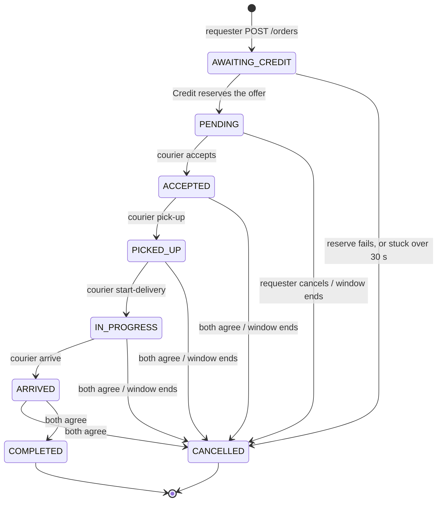

<!--
AI Assistance Disclosure:
Tool: Claude Code (model: Claude Opus 5.5), date: 2026-10-21
Scope: Wrote this description of the order lifecycle from the Order Service code (orders.service.ts, confirmations.service.ts, 001_init.sql). It documents existing behaviour and adds no design.
Author review: Pending: Deanson to review.
-->

# Order lifecycle

This describes how the Order Service handles an order's states, as implemented on `feature/order-service-real-time` on 2026-10-21. If this page and the code disagree, the code is right; update this page.

## States

| State | Meaning | Final? |
|---|---|---|
| `AWAITING_CREDIT` | Internal. The order is saved, and the service is waiting for Credit to reserve the offer. Couriers can't see it. | No |
| `PENDING` | Credits are reserved. Couriers can see and accept the order. | No |
| `ACCEPTED` | A courier is assigned. | No |
| `PICKED_UP` | The courier has the items. | No |
| `IN_PROGRESS` | The courier has left the pickup point. | No |
| `ARRIVED` | The courier is at the drop-off point. | No |
| `COMPLETED` | Both parties confirmed delivery. The credits go to the courier. | Yes |
| `CANCELLED` | The order ended without delivery. The credits go back to the requester. | Yes |

## Diagram

## Transitions

| From → To | Triggered by | Endpoint or job | `reason` in history | Event on `order.events` |
|---|---|---|---|---|
| new → `AWAITING_CREDIT` | Requester | `POST /orders` | — | none |
| `AWAITING_CREDIT` → `PENDING` | System, once Credit reserves the offer over HTTP | `POST /orders` (same request) | — | none |
| `AWAITING_CREDIT` → `CANCELLED` | System: Credit refused, failed or timed out, or the order was stuck for more than 30 s | `POST /orders`, or the 10 s settlement job | `CREDIT_NOT_RESERVED` | none (the requester never saw this order) |
| `PENDING` → `ACCEPTED` | Any user except the requester | `POST /orders/:orderId/accept` | — | `OrderAccepted` |
| `ACCEPTED` → `PICKED_UP` | Assigned courier | `POST /orders/:orderId/pick-up` | — | `OrderPickedUp` |
| `PICKED_UP` → `IN_PROGRESS` | Assigned courier | `POST /orders/:orderId/start-delivery` | — | `OrderInProgress` |
| `IN_PROGRESS` → `ARRIVED` | Assigned courier | `POST /orders/:orderId/arrive` | — | `OrderArrived` |
| `ARRIVED` → `COMPLETED` | Both parties approve a `COMPLETION` proposal | `POST /orders/:orderId/confirmations/:confirmationId/respond` | — | `OrderCompleted` |
| `PENDING` → `CANCELLED` | Requester alone | `POST /orders/:orderId/cancel` | `REQUESTER_CANCELLED` | `OrderCancelled` |
| `ACCEPTED` / `PICKED_UP` / `IN_PROGRESS` / `ARRIVED` → `CANCELLED` | Both parties approve a `CANCELLATION` proposal | `POST /orders/:orderId/confirmations/:confirmationId/respond` | `MUTUAL_CANCELLATION` | `OrderCancelled` |
| `PENDING` / `ACCEPTED` / `PICKED_UP` / `IN_PROGRESS` → `CANCELLED` | System, once the window has ended | 60 s expiry job | `EXPIRED` | `OrderCancelled` |

Every transition writes an `order_history` row in the same transaction as the state change. Editing a `PENDING` order (`PATCH /orders/:orderId`) and an approved timing change keep the status and write an `EDITED` history row; they publish no event.

## Rules for every step

- **Version check.** Every edit and step sends the order's `version` as the caller last loaded it. If the order has changed since, the request fails with `409 VERSION_CONFLICT`.
- **Window must not have ended.** Accepting, the courier steps and timing changes are refused once `window_end` has passed (`409 INVALID_STATE`). Cancelling is still allowed, by the requester or by agreement.
- **One active order per courier.** A courier with an order in `ACCEPTED`, `PICKED_UP`, `IN_PROGRESS` or `ARRIVED` can't accept another (`409 COURIER_BUSY`). A unique index enforces this, so if several couriers accept the same order at once, only one succeeds.
- **Access depends on the caller's link to the order**, never on the requester/courier UI mode. Only the requester can edit or cancel a `PENDING` order. Only the assigned courier can take the courier steps. The requester can't accept their own order.

## Proposals both parties must agree to

Once an order is accepted, the requester or the assigned courier can propose a change. The proposer counts as having agreed; the other party accepts or rejects it with `POST /orders/:orderId/confirmations/:confirmationId/respond`. Only one proposal per order can be waiting at a time (`409 CONFIRMATION_PENDING`).

| Kind | Allowed in | Window must not have ended? | When approved |
|---|---|---|---|
| `TIMING_CHANGE` | `ACCEPTED`, `PICKED_UP`, `IN_PROGRESS` | Yes | The window is updated (history `EDITED`). In `ACCEPTED`, the new window must still overlap the pickup's opening hours. |
| `CANCELLATION` | `ACCEPTED`, `PICKED_UP`, `IN_PROGRESS`, `ARRIVED` | No | → `CANCELLED` |
| `COMPLETION` | `ARRIVED` | No | → `COMPLETED` |

A proposal ends in one of these states:

- `APPROVED`: both parties accepted, and the change was applied.
- `REJECTED`: either party rejected it.
- `EXPIRED`: a timing change whose current or proposed window ended before it was approved. The expiry job also marks a pending timing change `EXPIRED` when it cancels the order.
- `SUPERSEDED`: the order moved on without it. This happens when the expiry job cancels the order while a cancellation is pending, or when the courier marks the order `ARRIVED` while a timing change is pending (`ARRIVED` allows no timing changes).

## Expiry

The expiry job runs every 60 s. It cancels orders in `PENDING`, `ACCEPTED`, `PICKED_UP` or `IN_PROGRESS` once `window_end` has passed. `ARRIVED` orders never expire; they end only by agreement. The job locks and rechecks each order first, so a step or approval that committed before it wins.

## Credits after a final state

- Credits are reserved over HTTP when the order is created.
- The settlement job runs every 10 s. For every `COMPLETED` or `CANCELLED` order whose credits aren't settled yet, it sends Credit a command on Kafka's `credit.commands` topic:
  - `TransferCredits` (to the courier) for `COMPLETED`;
  - `ReleaseCredits` (back to the requester) for `CANCELLED`.
- It sets `credit_settled_at` once Kafka has stored the command, so a crash resends the command. Credit ignores repeats.
- If Credit refused the reserve because the requester didn't have enough credits, nothing is held, so the order is marked settled straight away.

## Events

The service publishes `order_history` rows to `order.events` every second, oldest first. Each event is keyed by `orderId`, uses the history row's ID as `eventId`, and is delivered at least once. The payload contract is in [`order-service/AGENTS.md`](../../order-service/AGENTS.md) ("History and events").

| History action | Event |
|---|---|
| `ACCEPTED` | `OrderAccepted` |
| `PICKED_UP` | `OrderPickedUp` |
| `IN_PROGRESS` | `OrderInProgress` |
| `ARRIVED` | `OrderArrived` |
| `COMPLETED` | `OrderCompleted` |
| `CANCELLED` (not from `AWAITING_CREDIT`) | `OrderCancelled`, with `reason` |

`CREATED`, `CREDIT_RESERVED` and `EDITED` publish nothing, and neither does a create cancelled because credits weren't reserved.

## Source

- [`order-service/src/orders/orders.service.ts`](../../order-service/src/orders/orders.service.ts): create, edit, accept, courier steps, cancel, expiry, settlement
- [`order-service/src/orders/confirmations.service.ts`](../../order-service/src/orders/confirmations.service.ts): proposals
- [`order-service/migrations/001_init.sql`](../../order-service/migrations/001_init.sql): states, constraints and indexes
- [`order-service/AGENTS.md`](../../order-service/AGENTS.md): the decisions behind these rules
